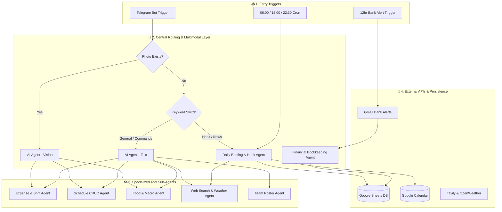
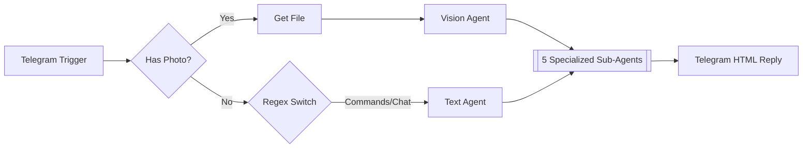
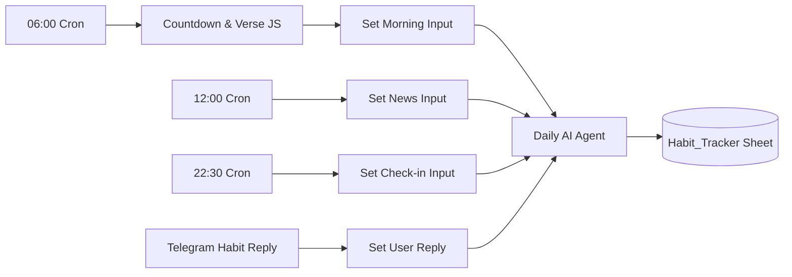
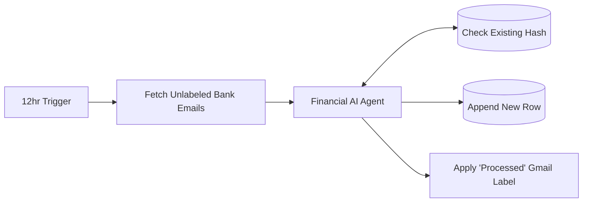

<div align="center">

# 🤖 Multi-Agent Automation & FinTech Pipeline
### 終極多代理自動化與個人金融管理系統

[](https://n8n.io/)
[](https://www.docker.com/)
[](https://caddyserver.com/)
[](https://core.telegram.org/bots/api)
[](https://deepmind.google/technologies/gemini/)

<p align="center">
  <a href="#-english-documentation"><b>🇬🇧 English Documentation</b></a> •
  <a href="#-繁體中文說明文件"><b>🇭🇰 繁體中文說明文件</b></a> •
  <a href="#-how-to-create-a-workflows-folder-on-github"><b>📁 How to Create Folder on GitHub</b></a> •
  <a href="#-security--privacy-audit"><b>🔒 Privacy Audit</b></a>
</p>

</div>

---

# 🇬🇧 English Documentation

## 📖 Overview
A production-grade, self-hosted workflow automation system deployed on a Linux VPS. This project integrates a unified **Telegram Multimodal AI Assistant** (supporting both Text and Vision) and a **Zero-Click Personal Finance & Shift Tracker**.

## 🛠 Tech Stack
| Layer | Technologies |
| :--- | :--- |
| **Infrastructure** | Linux VPS, Docker Compose, Caddy (Auto-TLS Reverse Proxy) |
| **Core Engine** | n8n (Self-Hosted Workflow Automation) |
| **AI & LLMs** | Google Gemini 2.5 Flash (Vision & Text), DeepSeek, OpenRouter, LangChain Agents |
| **Integrations** | Telegram Bot API, Google Sheets API, Google Calendar API (Primary & Shared Sync), Gmail API, Tavily Search, OpenWeatherMap |

---

## 🗺️ System Architecture (Full Overview)



---

## 🧩 Part-by-Part Breakdown

Click on each module below to expand its dedicated architecture diagram and workflow details. Corresponding modular JSON files are available in the `workflows/` directory.

<details open>
<summary><b>🔹 Part 1: Central Router & Multimodal Sub-Agents (<code>01-central-router-and-agents.json</code>)</b></summary>
<br>

**What it does:**
Acts as the single Telegram entry point. It inspects incoming messages for binary photos vs. text, routes them to either `AI Agent (Vision)` or `AI Agent (Text)`, and delegates tasks to 5 specialized sub-agents:
* **`ExpenseAgent`**: Logs daily expenses from text or receipt photos, updates monthly saving goals, and cross-references Google Calendar work shifts against Google Sheets to prevent duplicate shift entries.
* **`ScheduleAgent`**: Performs full CRUD on Google Calendar with automatic participant color-coding (`Color_ID`) and read-only shared calendar syncing.
* **`FoodAgent`**: Analyzes meal photos to estimate weight (g), calories (kcal), and macronutrients (carbs, protein, fat).
* **`Search Agent`**: Queries real-time weather (OpenWeatherMap) and web news (Tavily).
* **`Sports Roster Agent`**: Parses match-day lineups and updates player attendance (`✅`/`❌`) in Google Sheets.


</details>

<details>
<summary><b>🔹 Part 2: Daily Briefing, News Digest & Habit Tracker (<code>02-daily-briefing-and-habit-tracker.json</code>)</b></summary>
<br>

**What it does:**
Automates daily productivity routines across four operational modes:
* **Mode 1 (06:00 Morning Briefing):** Combines local weather forecasts, primary + shared calendar events, match countdown reminders, and a daily inspirational verse.
* **Mode 2 (12:00 News Digest & Pagination):** Curates 3 news stories each for *World*, *AI & Tech*, and *Local News*. Typing `more` or `continue` checks conversation memory and fetches the next 3 unseen articles.
* **Mode 3 & 4 (22:30 Habit & Journal Tracker):** Sends an evening check-in prompt and records reflections, reading minutes, mood scores (1–10), and 100% verbatim daily journals into Google Sheets.


</details>

<details>
<summary><b>🔹 Part 3: Zero-Click FinTech Auto-Bookkeeping (<code>03-fintech-auto-bookkeeping.json</code>)</b></summary>
<br>

**What it does:**
Polls banking transaction alert emails (Mox Bank, BOCHK, HSBC, PayMe, etc.) every 12 hours (or via iOS Shortcuts Webhook), extracts 7 standardized financial fields, verifies the transaction hash (`tx_hash`) against existing records to guarantee zero duplicates, appends the row to Google Sheets, and labels the email as processed.


</details>

---

# 🇭🇰 繁體中文說明文件

## 📖 專案簡介
這是一個部署於 Linux VPS 的生產級自託管（Self-Hosted）自動化系統。本專案整合了 **Telegram 多模態 AI 個人助理（支援圖片與文字辨識）** 以及 **全自動無感個人記帳與返工排班管理系統**。

## 🧩 模組化架構拆解 (Part-by-Part)

您可以在 `workflows/` 資料夾中選擇匯入 **完整版 (`00-full-multi-agent-pipeline.json`)**，或依需求單獨匯入以下三個子模組：

1. **第一部分：中央路由器與多代理工具群 (`01-central-router-and-agents.json`)**
   * **視覺與文字雙引擎：** 自動判斷 Telegram 訊息是否包含圖片（收據、餐點、行程表截圖），分流至 Vision 或 Text Agent。
   * **五大專屬子代理：** 涵蓋記帳與排班同步（自動比對 Google Calendar 班次防止重複寫入）、行事曆自動標色管理、飲食卡路里與三大營養素估算、即時新聞與天氣搜尋、以及球隊出席名單自動化點名。
2. **第二部分：每日晨報、新聞速報與習慣追蹤 (`02-daily-briefing-and-habit-tracker.json`)**
   * **06:00 晨報推送：** 整合當日天氣穿搭建議、雙日曆行程、賽事倒數行政提醒與每日金句。
   * **12:00 三大分類新聞速報：** 自動抓取【世界大事】、【AI & Technology】、【本地新聞】各 3 則，支援輸入 `more` 或 `continue` 結合記憶模組續讀新文章。
   * **22:30 晚間簽到與日誌：** 自動解析靈修反思、閱讀時間、心情評分，並 **100% 原文完整保留** 每日發生事項寫入 Google Sheets。
3. **第三部分：無感金融自動記帳管線 (`03-fintech-auto-bookkeeping.json`)**
   * **銀行通知自動解析：** 定期抓取銀行與電子錢包（Mox、BOCHK、HSBC、PayMe 等）交易通知信件。
   * **防重複寫入機制：** 自動生成唯一 `交易ID/Hash`，寫入前先檢視試算表既有紀錄，確認無重複後才寫入並標記郵件為「已記帳」。

---

## 📁 How to Create a `workflows/` Folder on GitHub
### 如何在 GitHub 建立 `workflows/` 資料夾並分類上傳

GitHub's web interface does not have a direct "New Folder" button, but you can create folders easily using either method below:

### Method A: Directly on the GitHub Website (Fastest)
1. Open your repository `tsekingyeung-lab/multi-agent-automation-pipeline` on GitHub.
2. Click **Add file** $\rightarrow$ **Create new file**.
3. In the **Name your file...** input box at the top, type `workflows/` — as soon as you type the slash `/`, GitHub automatically converts `workflows` into a directory!
4. Complete the filename as `workflows/00-full-multi-agent-pipeline.json`, paste the JSON content from the file generated here, and click **Commit changes**.
5. Repeat or click into the newly created `workflows/` folder and click **Add file** $\rightarrow$ **Upload files** to drag-and-drop `01`, `02`, and `03`.

### Method B: Via Local Folder Drag-and-Drop
1. On your computer, create a folder named `workflows` and save the 4 JSON files (`00` through `03`) inside it.
2. On your GitHub repository page, click **Add file** $\rightarrow$ **Upload files**.
3. Drag the entire `workflows` folder from your computer into the browser window and click **Commit changes**.

```text
📦 multi-agent-automation-pipeline
 ┣ 📂 workflows
 ┃ ┣ 📜 00-full-multi-agent-pipeline.json          # Complete All-in-One Workflow
 ┃ ┣ 📜 01-central-router-and-agents.json          # Part 1: Telegram Router + 5 Sub-Agents
 ┃ ┣ 📜 02-daily-briefing-and-habit-tracker.json   # Part 2: Morning Briefing, News & Habit Tracker
 ┃ ┗ 📜 03-fintech-auto-bookkeeping.json           # Part 3: Automated Bank Alert Bookkeeping
 ┣ 📜 docker-compose.yml                           # Self-Hosted n8n + Caddy Stack
 ┗ 📜 README.md                                    # Bilingual Documentation
```

---

## 🔒 Security & Privacy Audit

All files in this repository have been thoroughly sanitized before publication:
* **Personal Emails & Calendar IDs:** Replaced with `YOUR_PRIMARY_EMAIL@gmail.com` and `YOUR_SHARED_CALENDAR_ID@import.calendar.google.com`.
* **Telegram Identifiers:** Chat IDs and Webhook UUIDs replaced with `YOUR_TELEGRAM_CHAT_ID` and placeholder strings.
* **Google Spreadsheet IDs:** Document IDs replaced with `YOUR_GOOGLE_SHEET_ID` and `YOUR_ROSTER_SHEET_ID`.
* **API Credentials:** Internal n8n credential IDs replaced with `YOUR_*_CREDENTIAL_ID` placeholders.
* **Personal/Workplace References:** Specific shift codes, team names, and opponent names generalized to standard placeholders.
