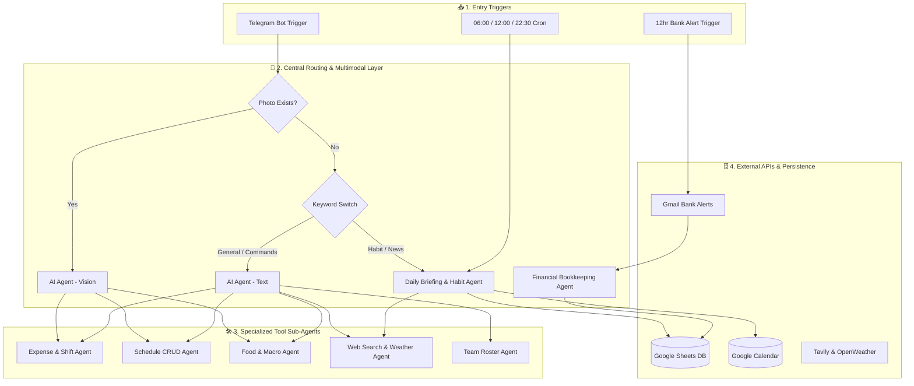
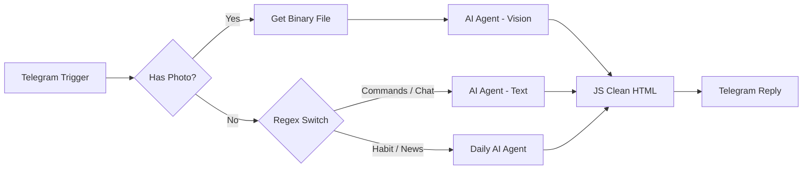
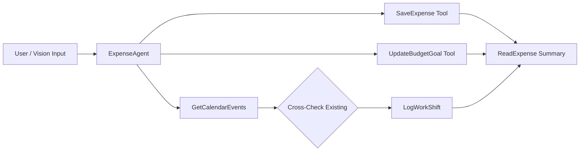
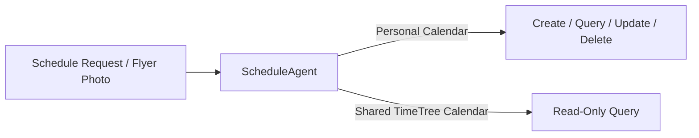
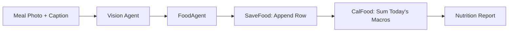
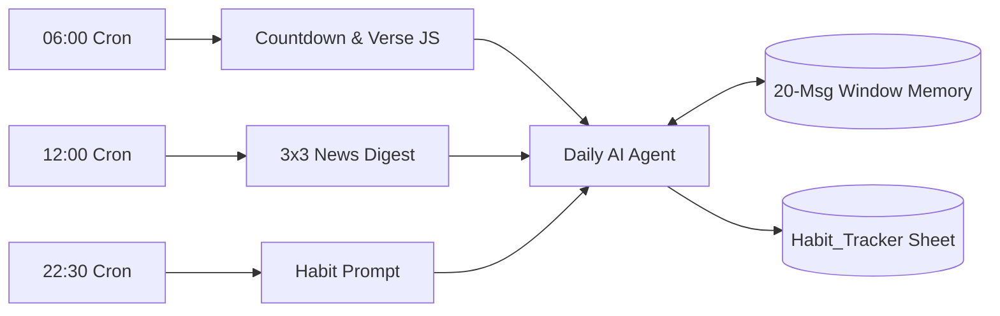
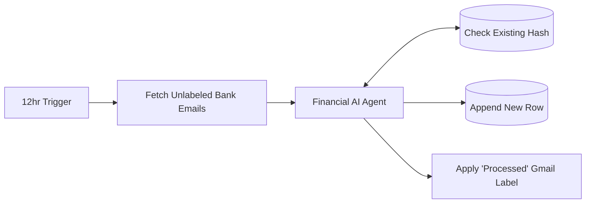

<div align="center">

# 🤖 Multi-Agent Automation & FinTech Pipeline

[](https://n8n.io/)
[](https://www.docker.com/)
[](https://caddyserver.com/)
[](https://core.telegram.org/bots/api)
[](https://deepmind.google/technologies/gemini/)

<br>

<!-- LANGUAGE SWITCHER BUTTONS -->
[-2ea44f?style=for-the-badge)](./README.md)
[](./README.zh-TW.md)

<p align="center">
  <a href="#-overview">Overview</a> •
  <a href="#️-system-architecture-full-overview">Architecture</a> •
  <a href="#-part-by-part-breakdown-8-core-modules">8 Core Modules</a> •
  <a href="#️-google-sheets-database-schema">Database Schema</a> •
  <a href="#-deployment--setup">Deployment</a> •
  <a href="#-security--privacy-audit">Privacy Audit</a>
</p>

</div>

---

## 📖 Overview
A production-grade, self-hosted workflow automation system deployed on a Linux VPS. This project integrates a unified **Telegram Multimodal AI Assistant** (supporting both Text and Vision) and a **Zero-Click Personal Finance & Shift Tracker**.

## 🛠 Tech Stack
| Layer | Technologies |
| :--- | :--- |
| **Infrastructure** | Linux VPS, Docker Compose, Caddy (Auto-TLS Reverse Proxy) |
| **Core Engine** | n8n (Self-Hosted Workflow Automation) |
| **AI & LLMs** | Google Gemini 2.5 Flash (Vision & Text), DeepSeek Chat, OpenRouter, LangChain Agents |
| **Integrations** | Telegram Bot API, Google Sheets API, Google Calendar API (Primary & Shared Sync), Gmail API, Tavily Search, OpenWeatherMap |

---

## 🗺️ System Architecture (Full Overview)



---

## 🧩 Part-by-Part Breakdown (8 Core Modules)

Click on any module below to expand its architecture diagram and technical logic.

<details open>
<summary><b>🔹 Module 1: Central Multimodal Router (<code>01-central-router-and-agents.json</code>)</b></summary>
<br>

**What it does:**
Acts as the single Telegram entry point. It inspects incoming webhook payloads for binary photos vs. text, routes image payloads to `AI Agent (Vision)` and text to a regex `Switch` router, and enforces strict Telegram HTML formatting (`<b>`, `<i>`, `<blockquote>`) on all outgoing messages.


</details>

<details>
<summary><b>🔹 Module 2: Expense, Budget & Work Shift Sync Sub-Agent (<code>ExpenseAgent</code>)</b></summary>
<br>

**What it does:**
Manages personal finances, monthly saving goals, and part-time/shift work tracking:
* **Receipt & Text Bookkeeping:** Extracts merchant, amount, category, and payment method from receipt photos or text messages, appending them to Google Sheets.
* **Budget & Saving Goal Management:** Updates monthly budget and saving targets (`config_row`) and calculates how many work shifts are required to hit the target.
* **Anti-Duplicate Work Shift Sync:** When triggered with *"Update work records"*, it queries Google Calendar for shift events, cross-references existing rows in the `Work_Records` sheet, and appends only newly completed shifts.


</details>

<details>
<summary><b>🔹 Module 3: Dual-Calendar CRUD & Color-Coding Sub-Agent (<code>ScheduleAgent</code>)</b></summary>
<br>

**What it does:**
Manages personal and shared schedules across two Google Calendars:
* **Access Control:** Full CRUD (`Create`, `Query`, `Update`, `Delete`) on the primary personal calendar, and strict read-only `Query` enforcement on the imported shared calendar (TimeTree sync).
* **Automatic Color-Coding (`Color_ID`):** Assigns Google Calendar color IDs automatically based on participants (`2` Green for solo, `5` Yellow for partner, `9` Blue for joint events, `4` Flamingo for anniversaries) and supports `RRULE` recurring events.


</details>

<details>
<summary><b>🔹 Module 4: Vision Food & Macronutrient Sub-Agent (<code>FoodAgent</code>)</b></summary>
<br>

**What it does:**
Triggered when a meal photo is sent to Telegram:
* Identifies up to 3 primary food items (sorted by calorie density) and incorporates user captions.
* Estimates weight (g), total calories (kcal), carbohydrates (g), protein (g), and fat (g).
* Calls `SaveFood` to log the meal, then immediately calls `CalFood` to aggregate and return the user's cumulative daily nutrition totals.


</details>

<details>
<summary><b>🔹 Module 5: Web Research, Categorized News & Weather Sub-Agent (<code>Search Agent</code>)</b></summary>
<br>

**What it does:**
Provides real-time external context using **Tavily Search** and **OpenWeatherMap**:
* Fetches current weather conditions, temperature ranges, and rain probabilities for morning outfit/umbrella recommendations.
* Searches and curates news across three categories: **World**, **AI & Technology**, and **Local (Hong Kong)**.
</details>

<details>
<summary><b>🔹 Module 6: Sports Team Roster & Attendance Sub-Agent (<code>RosterAgent</code>)</b></summary>
<br>

**What it does:**
Automates sports team management:
* Reads the master player roster from Google Sheets (`Read` tool).
* Parses unstructured match-day lineup messages from Telegram and updates every player's attendance column with `✅` or `❌` (`Attendance` tool), returning a headcount summary.
</details>

<details>
<summary><b>🔹 Module 7: Daily Briefing, News Pagination & Habit Tracker (<code>02-daily-briefing-and-habit-tracker.json</code>)</b></summary>
<br>

**What it does:**
Runs on scheduled Cron triggers and interactive replies:
* **06:00 Morning Briefing:** Combines weather, primary + shared calendar events, automated match administrative countdowns (14-day venue draw, 13-day poll, 1-day lineup, -1-day referee fee), and a random daily verse.
* **12:00 News Digest & Memory Pagination:** Delivers 9 curated news items (3 per category). Replying `more` or `continue` checks `Simple Memory` (20-message window) and fetches the next 3 unseen articles.
* **22:30 Habit & Verbatim Journal Tracker:** Prompts for evening reflections, reading minutes, mood score (1–10), and logs the user's daily journal **100% verbatim without summarization** into `Habit_Tracker`.


</details>

<details>
<summary><b>🔹 Module 8: Zero-Click FinTech Auto-Bookkeeping (<code>03-fintech-auto-bookkeeping.json</code>)</b></summary>
<br>

**What it does:**
Automates expense and income tracking from banking alerts (Mox Bank, BOCHK, HSBC, PayMe, FPS):
* Polls unprocessed banking emails every 12 hours (or receives payloads via iOS Shortcuts Webhook).
* Extracts 7 standardized fields and generates a deterministic `tx_hash` (Authorization reference or `YYYYMMDD_AMOUNT_MERCHANT`).
* Queries `check_existing_transactions` first—only appending new transactions and applying the `Processed` Gmail label afterward.


</details>

---

## 🗄️ Google Sheets Database Schema

To run this pipeline, create a Google Spreadsheet with the following **5 tabs**:

| Sheet Tab Name | Purpose | Required Columns |
| :--- | :--- | :--- |
| **`自動記帳資料庫`**<br>*(Auto Bookkeeping DB)* | Stores all expenses & FPS transfers | `日期時間`, `商戶/交易對象`, `金額`, `交易類型`, `支付方式`, `備註/原始通知`, `交易ID/Hash` |
| **`每月財務摘要`**<br>*(Monthly Financial Summary)* | Stores global budget config & formulas | `ID` (`config_row`), `每月薪金預算 ($)`, `目標儲蓄 ($)`, `每次返工日薪/時薪 ($)`, `總累計收入`, `總累計開支`, `目前已返幾多工` |
| **`返工紀錄`**<br>*(Work Shift Records)* | Synced work shifts from Google Calendar | `日期`, `工作名稱/地點`, `返工日數/時數`, `預計人工 ($)`, `備註` |
| **`Habit_Tracker`**<br>*(Daily Habit & Journal)* | Evening check-ins & verbatim journals | `Date`, `與主對話`, `讀經／書 (min)`, `心情 (1-10)`, `今日發生咩事 (完整紀錄)` |
| **`個人飲食日誌`**<br>*(Personal Food Log)* | Meal macro & calorie logs | `date`, `name`, `calories`, `carbohydrate`, `protein`, `fat` |

---

## 🚀 Deployment & Setup

### Repository Structure
```text
📦 multi-agent-automation-pipeline
 ┣ 📂 workflows
 ┃ ┣ 📜 00-full-multi-agent-pipeline.json          # Complete All-in-One Workflow
 ┃ ┣ 📜 01-central-router-and-agents.json          # Part 1: Telegram Router + 5 Sub-Agents
 ┃ ┣ 📜 02-daily-briefing-and-habit-tracker.json   # Part 2: Morning Briefing, News & Habit Tracker
 ┃ ┗ 📜 03-fintech-auto-bookkeeping.json           # Part 3: Automated Bank Alert Bookkeeping
 ┣ 📜 docker-compose.yml                           # Self-Hosted n8n + Caddy Stack
 ┣ 📜 Caddyfile                                    # Reverse Proxy Auto-HTTPS Config
 ┣ 📜 .env.example                                 # Environment Variables Template
 ┣ 📜 README.md                                    # English Documentation (Default)
 ┗ 📜 README.zh-TW.md                              # Traditional Chinese Documentation
```

### Quick Start
1. **Clone & Configure Environment:**
   ```bash
   git clone https://github.com/tsekingyeung-lab/multi-agent-automation-pipeline.git
   cd multi-agent-automation-pipeline
   cp .env.example .env
   nano .env
   ```
2. **Launch Docker Stack:**
   ```bash
   docker compose up -d
   ```
3. **Import Workflows into n8n:**
   Import either `workflows/00-full-multi-agent-pipeline.json` (complete system) or the modular files (`01`–`03`) into your n8n UI, and bind your credentials.

---

## 🔒 Security & Privacy Audit

All files in this repository have been thoroughly sanitized before publication:
- **Personal Emails & Calendar IDs:** Replaced with `YOUR_PRIMARY_EMAIL@gmail.com` and `YOUR_SHARED_CALENDAR_ID@import.calendar.google.com`.
- **Telegram Identifiers:** Chat IDs and Webhook UUIDs replaced with `YOUR_TELEGRAM_CHAT_ID` and placeholder strings.
- **Google Spreadsheet IDs:** Document IDs replaced with `YOUR_GOOGLE_SHEET_ID` and `YOUR_ROSTER_SHEET_ID`.
- **API Credentials:** Internal n8n credential IDs replaced with `YOUR_*_CREDENTIAL_ID` placeholders.
- **Personal/Workplace References:** Specific shift codes, team names, and opponent names generalized to standard placeholders.
