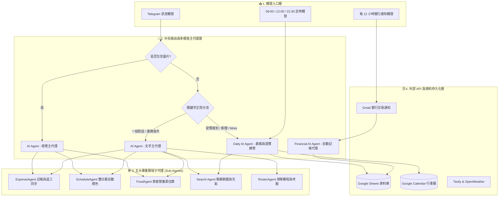
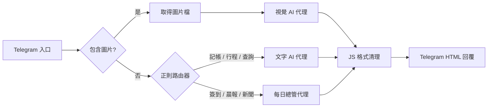
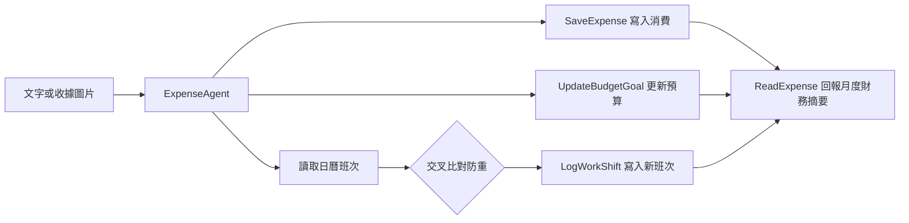
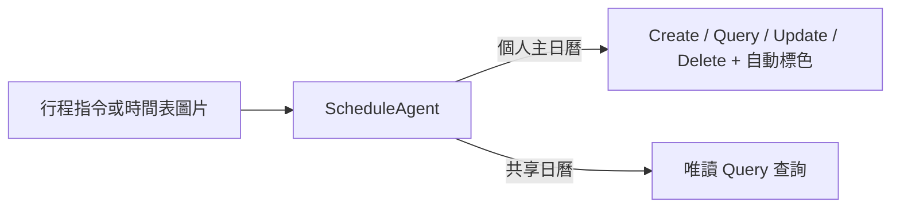
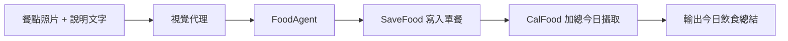
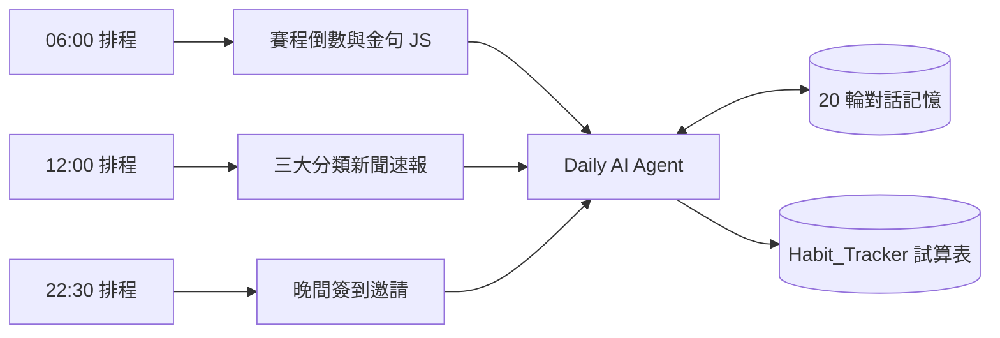
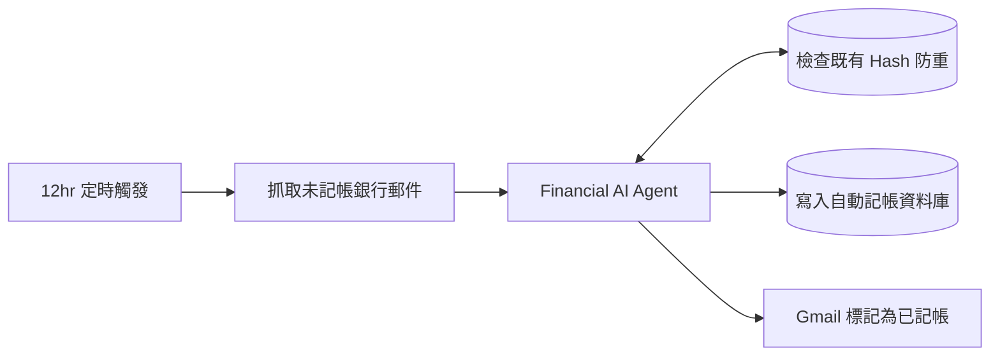

<div align="center">

# 🤖 終極多代理自動化與個人金融管理系統
### Multi-Agent Automation & FinTech Pipeline

[](https://n8n.io/)
[](https://www.docker.com/)
[](https://caddyserver.com/)
[](https://core.telegram.org/bots/api)
[](https://deepmind.google/technologies/gemini/)

<br>

<!-- 語言切換按鈕 -->
[](./README.md)
[-2ea44f?style=for-the-badge)](./README.zh-TW.md)

<p align="center">
  <a href="#-專案簡介">專案簡介</a> •
  <a href="#️-系統總體架構圖">系統架構圖</a> •
  <a href="#-八大核心模組詳細拆解">八大核心模組</a> •
  <a href="#️-google-sheets-資料庫結構">資料庫結構</a> •
  <a href="#-部署與安裝指南">部署指南</a> •
  <a href="#-資訊安全與隱私審查">隱私審查</a>
</p>

</div>

---

## 📖 專案簡介
這是一個部署於 Linux VPS 的生產級自託管（Self-Hosted）工作流自動化系統。本專案深度整合了 **Telegram 多模態 AI 個人助理（同時支援視覺圖片分析與自然語言對話）** 以及 **零點擊（Zero-Click）全自動個人記帳與返工排班管理系統**。

## 🛠 技術棧 (Tech Stack)
| 架構層級 | 使用技術 |
| :--- | :--- |
| **基礎設施層** | Linux VPS, Docker Compose, Caddy (自動申請與續期 HTTPS 反向代理) |
| **核心引擎層** | n8n (自託管工作流自動化引擎) |
| **AI 與大型語言模型** | Google Gemini 2.5 Flash (視覺與文字主腦), DeepSeek Chat, OpenRouter, LangChain Agents |
| **外部服務串接** | Telegram Bot API, Google Sheets API, Google Calendar API (個人主日曆與共享日曆同步), Gmail API, Tavily Search, OpenWeatherMap |

---

## 🗺️ 系統總體架構圖



---

## 🧩 八大核心模組詳細拆解

點擊下方各模組標題即可展開查看獨立流程圖與運作細節。所有對應之模組化 JSON 檔案皆位於 `workflows/` 資料夾中。

<details open>
<summary><b>🔹 模組一：Telegram 多模態中央路由器 (<code>01-central-router-and-agents.json</code>)</b></summary>
<br>

**功能說明：**
作為 Telegram 唯一入口，自動檢測傳入訊息是否夾帶圖片：
* **圖片分流：** 若包含照片（餐點、收據、行程海報），自動下載 Binary 檔案並交由 `AI Agent (Vision)` 進行多模態分析。
* **文字正則分流：** 若為純文字，透過 `Switch` 節點識別是否為「習慣打卡／新聞續讀」或「一般業務指令」，並強制所有輸出遵循 Telegram HTML 標籤規範（`<b>`, `<i>`, `<blockquote>`）。


</details>

<details>
<summary><b>🔹 模組二：日常記帳、儲蓄目標與返工排班同步子代理 (<code>ExpenseAgent</code>)</b></summary>
<br>

**功能說明：**
專責管理個人開支、薪金預算與兼職／排班工時統計：
* **對話與收據記帳：** 自動提取商戶、金額、分類與支付方式寫入「自動記帳資料庫」，並即時回報當月淨結餘與剩餘可用預算。
* **儲蓄目標與工時換算：** 支援動態修改每月薪金預算、目標儲蓄金額與單次返工日薪（透過匹配 `config_row`），自動計算還需返多少班次才能達成儲蓄目標。
* **防重複返工紀錄同步：** 當輸入「更新返工紀錄」時，自動搜尋本月 Google Calendar 上的返工班次，並與試算表「返工紀錄」交叉比對，確保只寫入未記錄的新班次。


</details>

<details>
<summary><b>🔹 模組三：雙日曆權限控管與自動標色子代理 (<code>ScheduleAgent</code>)</b></summary>
<br>

**功能說明：**
同時管理個人主日曆與共享日曆（如 TimeTree 匯入日曆）：
* **嚴格權限隔離：** 個人主日曆支援完整新增、查詢、修改、刪除（CRUD）；共享日曆則在系統提示詞層級強制鎖定為「唯讀查詢（Query Only）」，防止誤改共享行程。
* **智慧顏色標籤 (`Color_ID`)：** 新增或更新行程時自動依參與者設定顏色（`2` 綠色代表個人行程、`5` 黃色代表伴侶行程、`9` 藍色代表共同行程、`4` 粉紅色代表每月固定紀念日），並支援 `RRULE` 重複事件語法。


</details>

<details>
<summary><b>🔹 模組四：視覺飲食熱量與三大營養素估算子代理 (<code>FoodAgent</code>)</b></summary>
<br>

**功能說明：**
傳送餐點照片至 Telegram 時自動觸發：
* 辨識照片中熱量最高的前 3 項主要食物，並優先參考使用者輸入的文字說明（Caption）。
* 自動估算每項食物重量（g）、總熱量（kcal）、碳水化合物（g）、蛋白質（g）與脂肪（g）。
* 先呼叫 `SaveFood` 寫入單餐紀錄，再立即呼叫 `CalFood` 讀取並加總當日所有已攝取熱量與營養素。


</details>

<details>
<summary><b>🔹 模組五：聯網研究、三大分類新聞與天氣子代理 (<code>Search Agent</code>)</b></summary>
<br>

**功能說明：**
串接 **Tavily Search API** 與 **OpenWeatherMap API**：
* 即時查詢香港當日氣溫、天氣狀況與降雨機率，提供晨報穿搭與雨具建議。
* 執行網路事實查核，並針對【世界大事】、【AI & Technology】、【本地新聞】三大分類進行即時新聞檢索。
</details>

<details>
<summary><b>🔹 模組六：球隊賽程查詢與考勤點名子代理 (<code>RosterAgent</code>)</b></summary>
<br>

**功能說明：**
自動化處理球隊聯賽與友誼賽行政工作：
* 呼叫 `Read` 工具讀取試算表中的全隊球員名冊與聯賽賽程表。
* 當收到 Telegram 傳來的比賽陣容／出席名單（Match Day 格式）時，自動比對全隊名單並逐一呼叫 `Attendance` 工具，在對應賽事欄位打勾（`✅`）或打叉（`❌`），最後統計出席與缺席人數。
</details>

<details>
<summary><b>🔹 模組七：每日晨報、新聞續讀與晚間習慣追蹤 (<code>02-daily-briefing-and-habit-tracker.json</code>)</b></summary>
<br>

**功能說明：**
結合定時排程（Cron）與對話記憶（Simple Memory 20 輪上下文）的四大運作模式：
* **模式一（06:00 晨報推送）：** 透過自訂 JavaScript 節點計算距離下一場球賽的天數（提前 14 天提醒抽籤場地、13 天提醒發起投票、賽前 1 天提醒交名單與安排主場拍攝、賽後 1 天提醒繳交球證費），並結合隨機聖經金句、今日天氣與雙日曆行程推送晨報。
* **模式二（12:00 新聞速報與無縫續讀）：** 推送三大分類各 3 則最新新聞（附帶發布時間與原文連結）。當使用者回覆 `more`、`continue` 或 `繼續` 時，自動檢視對話記憶中已讀過的新聞，搜尋並列出接下來全新的 3 則新聞。
* **模式三 & 四（22:30 晚間簽到與 100% 原文日誌）：** 晚間主動發送反思邀請，並在收到回覆後自動解析「與主對話」、「讀經／閱讀時間」、「心情指數 (1-10)」，且**嚴格保留「今日發生咩事」100% 完整原文（絕不濃縮或改寫）**寫入 `Habit_Tracker` 分頁。


</details>

<details>
<summary><b>🔹 模組八：零點擊金融通知自動記帳管線 (<code>03-fintech-auto-bookkeeping.json</code>)</b></summary>
<br>

**功能說明：**
全自動解析銀行與電子錢包交易郵件（支援 Mox Bank、BOCHK 中銀香港、HSBC 滙豐、PayMe、轉數快 FPS 等）：
* **自動收信與分類：** 每 12 小時自動抓取未標記為「已記帳」的交易信件，自動區分信用卡消費、回贈、FPS 轉入收款（正數）與轉出付款。
* **Hash 防重複機制：** 自動提取銀行參考編號或生成 `YYYYMMDD_金額_商戶大寫` 作為唯一 `交易ID/Hash`。寫入前強制先呼叫 `check_existing_transactions` 比對既有紀錄，確保零重複記帳，完成後自動為 Gmail 郵件貼上處理完畢標籤。


</details>

---

## 🗄️ Google Sheets 資料庫結構

若要完整運行本系統，請在 Google Sheets 建立以下 **5 個工作表分頁**：

| 分頁名稱 | 用途說明 | 必備欄位名稱 |
| :--- | :--- | :--- |
| **`自動記帳資料庫`** | 儲存所有日常消費與銀行自動化記帳紀錄 | `日期時間`, `商戶/交易對象`, `金額`, `交易類型`, `支付方式`, `備註/原始通知`, `交易ID/Hash` |
| **`每月財務摘要`** | 儲存每月預算設定與自動加總公式 | `ID` (第2列填 `config_row`), `每月薪金預算 ($)`, `目標儲蓄 ($)`, `每次返工日薪/時薪 ($)`, `總累計收入`, `總累計開支`, `目前已返幾多工` |
| **`返工紀錄`** | 儲存與 Google Calendar 同步之排班紀錄 | `日期`, `工作名稱/地點`, `返工日數/時數`, `預計人工 ($)`, `備註` |
| **`Habit_Tracker`** | 儲存每日晚間簽到與完整日記原文 | `Date`, `與主對話`, `讀經／書 (min)`, `心情 (1-10)`, `今日發生咩事 (完整紀錄)` |
| **`個人飲食日誌`** | 儲存每日餐點熱量與三大營養素數據 | `date`, `name`, `calories`, `carbohydrate`, `protein`, `fat` |

---

## 🚀 部署與安裝指南

### 專案目錄結構
```text
📦 multi-agent-automation-pipeline
 ┣ 📂 workflows
 ┃ ┣ 📜 00-full-multi-agent-pipeline.json          # 完整合一版工作流 (All-in-One)
 ┃ ┣ 📜 01-central-router-and-agents.json          # 第一部分：中央路由器與五大子代理
 ┃ ┣ 📜 02-daily-briefing-and-habit-tracker.json   # 第二部分：每日晨報、新聞與習慣追蹤
 ┃ ┗ 📜 03-fintech-auto-bookkeeping.json           # 第三部分：銀行郵件無感自動記帳
 ┣ 📜 docker-compose.yml                           # n8n + Caddy 容器化編排設定
 ┣ 📜 Caddyfile                                    # Caddy 自動 HTTPS 反向代理設定
 ┣ 📜 .env.example                                 # 環境變數範本檔
 ┣ 📜 README.md                                    # 英文版說明文件 (預設首頁)
 ┗ 📜 README.zh-TW.md                              # 繁體中文版說明文件 (本頁)
```

### 快速啟動步驟
1. **複製專案並設定環境變數：**
   ```bash
   git clone https://github.com/tsekingyeung-lab/multi-agent-automation-pipeline.git
   cd multi-agent-automation-pipeline
   cp .env.example .env
   nano .env
   ```
2. **啟動 Docker 容器服務：**
   ```bash
   docker compose up -d
   ```
3. **匯入 n8n 工作流：**
   進入自託管之 n8n 網頁介面，選擇匯入 `workflows/00-full-multi-agent-pipeline.json`（完整版）或分批匯入 `01` 至 `03` 模組，並綁定您的 API 憑證即可啟用。

---

## 🔒 資訊安全與隱私審查

本儲存庫中的所有檔案皆已通過嚴格的去識別化處理（Sanitization），確保不會洩露任何個人隱私：
- **個人信箱與日曆 ID：** 已全數替換為 `YOUR_PRIMARY_EMAIL@gmail.com` 與 `YOUR_SHARED_CALENDAR_ID@import.calendar.google.com`。
- **Telegram 識別碼：** 個人 Chat ID 與 Webhook UUID 已全數替換為 `YOUR_TELEGRAM_CHAT_ID` 等通用佔位符。
- **Google 試算表 ID：** 所有真實試算表網址與 Document ID 已替換為 `YOUR_GOOGLE_SHEET_ID` 與 `YOUR_ROSTER_SHEET_ID`。
- **API 憑證 ID：** n8n 內部憑證編號已替換為 `YOUR_*_CREDENTIAL_ID`。
- **個人與工作細節：** 具體工作班次代號、球隊名稱與比賽對手名稱均已替換為通用範例文字。
